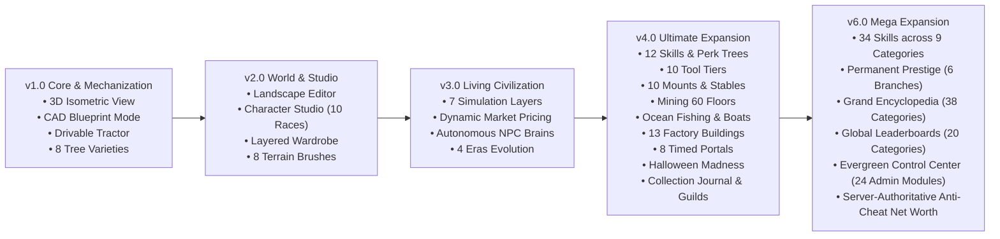

# 🌲 EVERGREEN CHRONICLES ONLINE (v1.0 — v6.0 Mega Expansion)

> **Cozy Fantasy Life-Simulation Sandbox, Mechanized Farming, Living Civilization & Endless Exploration**  
> *Author: FahmiGF — Medieval to Modern Fantasy Architecture*

[-emerald.svg)]()
[]()
[]()
[]()

---

## 🗺️ Roadmap & Version History



---

## 🌟 Version Highlights Breakdown

### 🚜 Version 1.0.0 — Core Simulation & Mechanized Farming
- **Multi-Perspective Rendering**: Seamless switching between **2D Classic Top-Down (`[V]`)**, **3D Isometric Depth Projection (`[V]`)**, and **CAD Blueprint Mode (`[B]`)**.
- **Mechanized Tractor System**: Drivable agricultural tractor with 3 specialized modular implements (**Tiller**, **Sprayer**, **Mower**), functional horn (`[H]`), exhaust particle physics, and 3x swath area clearing.
- **8 Distinct Tree Varieties**: Oak, Pine, Birch, Willow, Lumina, Cherry, Ironbark, and Golden Apple with individual growth cycles, wood types, and seasonal drops.
- **Dynamic Time & Weather**: 24-hour day/night lighting cycles, real-time rain/storm particle effects, and 4 in-game seasons.

### 🎨 Version 2.0.0 — World Customization & Character Studio
- **Terrain Landscape Painter (`[L]`)**: In-game real-time terrain brush dock (Grass, Dirt, Water, Stone, Sand, Cobblestone, Wood Flooring, Flower Meadow) with variable radius (1x1 to 3x3).
- **Comprehensive Character Studio (`[P]`)**: 
  - **10 Playable Races**: Human, Elf, Dwarf, Beastkin, Celestian, Shadowkin, Dragonkin, Dryad, Automaton, Merfolk with distinct passive kingdom traits.
  - **Full Customization**: 8 facial shapes, 12 skin tones, 16 hair styles with highlights, facial markings, and body build types.
  - **Layered Wardrobe & Outfits**: Headwear, tops, bottoms, footwear, back accessories, and 4 one-click outfit presets (*Work*, *Adventure*, *Formal*, *Sleepwear*).

### 🏛️ Version 3.0.0 — Living Civilization Engine & Server Architecture
- **7-Layer Civilization Simulation**:
  1. *Population*: Happiness, housing capacity, migration rate.
  2. *Economy*: Liquidity, town business revenues, municipal tax reserves.
  3. *Infrastructure*: Road quality, pressurized irrigation coverage, electrification.
  4. *Social*: Community cohesion, safety index, town mutual aid.
  5. *Governance*: Prosperity score, era progression policies.
  6. *Environment*: Soil fertility, ancient forest conservation, air quality.
  7. *Culture*: Heritage archival, seasonal festival readiness.
- **Dynamic Market Economy**: Real-time supply-and-demand price calculations with elastic price ceilings and floors across 8 core commodities.
- **Autonomous NPC Brains**: 24-hour activity routines, multi-dimensional relationships (Trust, Respect, Friendship, Familiarity, Cooperation), bounded episodic memory banks, and procedural shortage quest generation.
- **Cryptographic Save Persistence**: Version 2.0.0+ engine with SHA-256 integrity checksums, two-stage atomic file writing, and auto-repair.

### 🌌 Version 4.0.0 — Ultimate Expansion Update
- **12 Player Skills & Branching Perk Trees (`[K]`)**:
  - Skills: *Farming*, *Mining*, *Fishing*, *Foraging*, *Crafting*, *Combat*, *Cooking*, *Social*, *Exploration*, *Animal Care*, *Building*, *Magic*.
  - Milestones (Lv 1–100): *Beginner*, *Apprentice*, *Skilled*, *Expert*, *Master*, *Grandmaster*, *Legendary*.
  - 3 branches per skill with 5 perks each (e.g. *Crop Mastery*, *Land Mastery*, *Nature Harmony*).
  - Prestige system for Level 50+ mastery skills with exclusive badges and titles.
- **10 Tool Tiers & Equipment Progression**:
  - Tiers: *Wooden* → *Copper* → *Iron* → *Silver* → *Gold* → *Platinum* → *Mythril* → *Crystal* → *Ancient* → *Celestial*.
  - Durability decay, blacksmith repairs, and socketable enchantments (*Fortune*, *Swift Strike*, *Auto-Smelt*, *Multi-Tile*, *Radiance*).
- **10 Mounts & Stables System (`[R]`)**:
  - Mounts: Horse, Pony, Deer, Giant Rabbit, Alpaca, Snow Wolf, Crystal Fox, Dawn Unicorn, Sky Griffin, Ancient Dragon (+40% to +175% move speed).
  - Bonding interactions: Feed, Groom, Play, Train with happiness and stamina bars.
  - Stable upgrades across 6 tiers (Small Stable to Celestial Sanctuary).
- **Goa Tambang 60 Lantai & Mesin Pengolah (`[M]`)**:
  - 10 underground zones (Abandoned Quarry to Celestial Mine) with elevator checkpoints every 5 floors.
  - Machinery: Blast Smelter (ingots), Ore Crusher (geodes), Gem Polisher (faceted royal gems), and automated minecart routing.
- **Perikanan Samudra & Armada Kapal**:
  - 7 aquatic zones: *Peaceful Lake*, *River Valley*, *Coastal Beach*, *Coral Reef*, *Deep Ocean*, *Sunken Kingdom*, *Frozen Sea*.
  - 5 boat tiers (Wooden Raft to Arcane Skiff) and Village Aquarium specimen length records.
- **Satwa Pendamping & Peternakan Hewan**:
  - 10 Companion pets with active passive traits (*Treasure Sniffer*, *Cozy Purr*, etc.).
  - Ranch facilities: Chicken Coop, Cow Barn, Alpaca Sanctuary, and Apiary with daily harvests.
- **13 Fasilitas Produksi & Otomasi Pabrik**:
  - Buildings: Greenhouse, Bakery, Dairy, Juice House, Textile Workshop, Carpenter, Blacksmith, Alchemy Lab, Gem Workshop, Automated Factory, Research Center, Trading Post, Warehouse.
  - Automated irrigation and asynchronous batch processing queues.
- **8 Portal Dimensi & Event Halloween Madness (`[N]` / `[X]`)**:
  - 8 Timed Portals with live countdown clocks and dimensional relic drops.
  - Halloween Madness: Spooky village decor, Ghost Pumpkin farming, NPC Trick-or-Treating, and Spooky Vanity Shop.
- **Buku Koleksi, Pencapaian & Guild (`[Y]`)**:
  - Master collection encyclopedia tracking completion % across crops, minerals, and fish.
  - 25+ structured achievements with gold claims.
  - 7 Player Guilds with passive profession perks.

### 👑 Version 6.0.0 — Mega Expansion: Progression, Encyclopedia, Leaderboards & Control Center
- **Advanced Mastery Engine & 34 Skills (`[K]`)**:
  - Expanded across 9 categories (*Agriculture*, *Livestock*, *Industry*, *Nature*, *Adventure*, *Ocean*, *Social*, *Technology*, *Creativity*).
  - 6 Cross-discipline **Skill Synergies** (e.g. Agronomy + Cooking, Mining + Engineering, Robotics + Farming).
  - **6 Permanent Prestige Upgrade Branches** (*Prosperity*, *Nature*, *Industry*, *Discovery*, *Fellowship*, *Innovation*) with 100% safe non-destructive PP refunds.
- **Grand Encyclopedia & World Journal (`[J]`)**:
  - 38 index categories tracking crops, vegetables, flowers, fish, artifacts, recipes, pets, mounts, robots, biomes, portals, and weather.
  - Category completion tracking and 5 milestone reward tiers (10%, 25%, 50%, 75%, 100%) with gold, PP, and exclusive titles.
- **Global Leaderboards & Anti-Cheat Validation**:
  - 20 competitive categories with *All-Time*, *Season*, *Monthly*, *Weekly*, and *Daily* filters.
  - Server-authoritative Net Worth valuation formula preventing client currency manipulation.
  - Granular privacy toggles (*Public Profile*, *Show Net Worth*, *Show Guild*).
- **In-Game Admin Dashboard (Evergreen Control Center) (`[F1]` / `[~]`)**:
  - Compact `[⚙️ ADMIN]` tab on HUD with role-based access control (RBAC).
  - 24 Control modules: System Telemetry (60 TPS), Staged Isolated Event Testing (Carnival, Halloween, Starfall), Quest Lab with cycle detection, World Clock & Season shifter, Weather changer, Economy price shock simulator, Farming instant crop booster, Robotics fleet diagnostics, and Automated QA Suite runner.
  - Immutable append-only audit trail logging all administrative actions.

---

## 🎮 Keyboard Controls & Hotkeys

| Key | Action |
| :--- | :--- |
| **`W, A, S, D`** / **Arrows** | Gerak Karakter / Kemudi Traktor / Satwa Tunggangan |
| **`[V]`** | Ganti Tampilan Kamera: **2D Top-Down** ⟷ **3D Isometrik** |
| **`[B]`** | Mode Arsitektur Cetak Biru CAD |
| **`[K]`** | Buka Pusat Progresi, 34 Keahlian & Cabang Prestige |
| **`[J]`** | Buka Grand Encyclopedia 38 Kategori & Jurnal Dunia |
| **`[F1]`** / **`[~]`** | Buka Evergreen Control Center (Admin Dashboard) |
| **`[R]`** | Buka Kandang Satwa & Tunggangi Mount |
| **`[M]`** | Buka Goa Tambang 60 Lantai & Mesin Pengolah |
| **`[N]`** / **`[X]`** | Buka Portal Dimensi & Event Musiman Halloween |
| **`[Y]`** | Buka Ensiklopedia Koleksi, Pencapaian & Guild |
| **`[C]`** | Buka Dashboard Pusat Peradaban & Pasar Dinamis |
| **`[P]`** | Buka Studio Karakter & Lemari Busana |
| **`[L]`** | Aktifkan Palet Kuas Lanskap & Terrain |
| **`[E]`** | Buka Inventaris Tas Pemain |
| **`[F]`** | Melempar Joran Pancing di Perairan |
| **`[Q]`** | Buka Log Buku Tugas Warga |
| **`[U]`** | Buka Tingkat Kasih Penduduk Desa |
| **`[H]`** | Membunyikan Klakson Traktor (*Honk!*) |
| **`[1, 2, 3]`** | Ganti Implemen Traktor: Bajak Tanah / Semprot Air / Babat Rumput |
| **`[ESC]`** | Menutup jendela modal aktif |

---

## 🚀 Instalasi & Menjalankan Game

### 1. Backend Server (FastAPI + WebSocket)
```bash
cd backend
python -m venv venv
# Windows:
.\venv\Scripts\activate
# Linux/macOS:
source venv/bin/activate

pip install -r requirements.txt
uvicorn app.main:app --host 0.0.0.0 --port 8000 --reload
```

### 2. Frontend Web App (Vite + React)
```bash
cd frontend
npm install
npm run dev
```
Buka browser di `http://localhost:5173`.

### 3. Menjalankan Tes Otomatis
```bash
cd backend
pytest -o pythonpath=.
```
*Hasil: 43/43 tes unit & integrasi lulus dalam ~2 detik.*

---

## 📦 Dokumentasi Lengkap
- [Arsitektur Server & WebSockets](docs/SERVER_ARCHITECTURE.md)
- [Desain Sistem UI/UX](docs/DESIGN_SYSTEM.md)
- [Art Bible & Pedoman Visual Pixel](docs/ART_BIBLE.md)
- [Skema Basis Data & GameSave](docs/DATABASE_SCHEMA.md)
- [Spesifikasi Ekspansi V4](docs/V4_EXPANSION_SPEC.md)
- [Laporan Pengujian Kualitas V4](docs/TESTING_REPORT_V4.md)
- [Changelog V4.0.0](docs/CHANGELOG_V4.md)

---
*© 2026 Evergreen Chronicles Project by FahmiGF. Open source under MIT License.*
