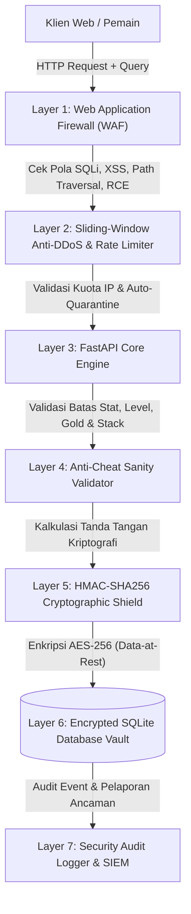

# EVERGREEN CHRONICLES — ENTERPRISE CYBERSECURITY & ANTI-HACK SPECIFICATION (V7.0)

## 1. Ringkasan Arsitektur Keamanan (Defense-in-Depth)

Sistem keamanan Evergreen Chronicles V7.0 dirancang menggunakan prinsip **Defense-in-Depth** berlapis ganda untuk mencegah penyerang, cheater, maupun bot mengakses database, memanipulasi file simpanan (*save games*), merusak integritas state pemain, atau melancarkan eksploitasi injeksi terhadap server.



---

## 2. Rincian Lapisan Pertahanan

### Lapisan 1: Web Application Firewall (WAF) & Injection Defense
* **Lokasi**: [`backend/app/security_engine.py`](file:///C:/Kuliah%20Sisfor/Github%20Project/evergreen-chronicles/backend/app/security_engine.py) — `WAFEngine`
* **Mekanisme**: Memeriksa seluruh parameter query, path URL, body payload, dan HTTP headers secara real-time.
* **Pola Serangan yang Diblokir**:
  * **SQL Injection (SQLi)**: `UNION SELECT`, `' OR 1=1`, `DROP TABLE`, `INFORMATION_SCHEMA`, `SLEEP()`, `BENCHMARK()`.
  * **Cross-Site Scripting (XSS)**: `<script>`, `javascript:`, `onerror=`, `onload=`, `<iframe`, `document.cookie`.
  * **Path Traversal & Directory Traversal**: `../`, `..\`, `%2e%2e`, `/etc/passwd`, `C:\Windows\System32`.
  * **Remote Code Execution (RCE)**: `system()`, `popen()`, `exec()`, `; rm `, `| whoami`, `curl http`.
  * **Prototype Pollution**: `__proto__`, `constructor.prototype`.
* **Aksi Penolakan**: Menolak request dengan HTTP 403 Forbidden, mencatat insiden ke SIEM, dan menghitung skor pelanggaran IP penyerang.

### Lapisan 2: Anti-DDoS & Sliding-Window Rate Limiter
* **Lokasi**: [`backend/app/security_engine.py`](file:///C:/Kuliah%20Sisfor/Github%20Project/evergreen-chronicles/backend/app/security_engine.py) — `RateLimiter`
* **Mekanisme**:
  * Membatasi request umum maksimal **120 request/menit** per alamat IP.
  * Membatasi endpoint sensitif (Simpan Save, Admin, Security) maksimal **30 request/menit**.
  * **Auto-Quarantine (Auto-Ban)**: Jika suatu IP memicu 3 pelanggaran keamanan, sistem otomatis memasukkan IP tersebut ke tabel karantina `blocked_ips` selama 15 menit (900 detik).

### Lapisan 3: Anti-Cheat & Game State Sanity Validator
* **Lokasi**: [`backend/app/security_engine.py`](file:///C:/Kuliah%20Sisfor/Github%20Project/evergreen-chronicles/backend/app/security_engine.py) — `AntiCheatValidator`
* **Mekanisme**: Memeriksa integritas logika permainan sebelum diizinkan masuk ke memori atau database:
  * **Gold Bounds**: Menolak nilai negatif, NaN, float infinity, dan overflow (Maksimal `999,999,999`).
  * **Level & XP Bounds**: Level maksimal 100, XP maksimal 100,000,000.
  * **Health & Energy Bounds**: Nilai stat antara 0 hingga batas legal (Maksimal 2,000).
  * **Inventory Duplication Protection**: Menolak kuantitas item negatif (yang biasa dipakai untuk exploit duplikasi item tak terbatas).
  * **Movement & Teleport Boundaries**: Menolak koordinat X/Y pemain yang meloncat di luar grid dunia legal.

### Lapisan 4: HMAC-SHA256 Cryptographic Signature & Anti-Tamper
* **Lokasi**: [`backend/app/security_engine.py`](file:///C:/Kuliah%20Sisfor/Github%20Project/evergreen-chronicles/backend/app/security_engine.py) — `HMACIntegrityShield`
* **Mekanisme**: Setiap simpanan permainan ditandatangani secara kriptografis menggunakan kunci rahasia server (*server-side master pepper*).
* **Perlindungan**: Jika cheater mengedit berkas JSON secara lokal (mengubah gold, menaikkan level secara manual), tanda tangan HMAC menjadi tidak valid. Server akan mendeteksi perbedaan hash secara instan, menolak simpanan, dan mengisolasi berkas tersebut ke tabel `quarantined_saves`.

### Lapisan 5: Enkripsi Database Data-at-Rest (AES-256 Vault)
* **Lokasi**: [`backend/app/security_engine.py`](file:///C:/Kuliah%20Sisfor/Github%20Project/evergreen-chronicles/backend/app/security_engine.py) — `DatabaseSecurity`
* **Mekanisme**: Seluruh data pemain yang disimpan pada basis data SQLite lokal (`evergreen_vault.db`) dienkripsi penuh menggunakan **AES-256-Fernet** dengan HMAC authenticated payload.
* **Perlindungan**: Sekalipun penyerang berhasil mencuri berkas database fisik dari server, isi simpanan tidak dapat dibaca karena tersimpan dalam bentuk ciphertext terenkripsi (bukan plaintext JSON).
* **Zero SQL Injection**: Seluruh query SQLite ditulis menggunakan parameterized queries (`?`), menjamin keamanan 100% dari SQL Injection pada database engine.

### Lapisan 6: Enterprise Defensive HTTP Headers
Setiap response yang dikirim server menyertakan header keamanan modern:
* `X-Content-Type-Options: nosniff` (Mencegah MIME-type sniffing)
* `X-Frame-Options: DENY` (Mencegah Clickjacking)
* `X-XSS-Protection: 1; mode=block` (Mencegah Reflected XSS)
* `Strict-Transport-Security: max-age=31536000; includeSubDomains` (Memaksa koneksi aman HTTPS)
* `Content-Security-Policy: default-src 'self' ...` (Membatasi eksekusi resource eksternal)
* `Referrer-Policy: strict-origin-when-cross-origin` (Melindungi privasi referer)
* `X-Anti-Hack-Engine: Evergreen-Guardian-v7.0` (Identifikasi pelindung aktif)

### Lapisan 7: Security Audit Logging & SIEM Telemetry
* Menyimpan log insiden ke SQLite (`security_audit_logs`) dan memory buffer.
* Endpoint pengawasan:
  * `GET /api/v1/security/overview`: Status firewall, tingkat ancaman (GREEN / YELLOW / RED), jumlah serangan yang diblokir, dan daftar modul proteksi.
  * `GET /api/v1/security/audit-logs`: Daftar histori kejadian keamanan.
  * `POST /api/v1/security/unblock-ip`: Membuka blokir IP oleh administrator.
  * `POST /api/v1/security/verify-integrity/{slot_id}`: Verifikasi kriptografi simpanan.

---

## 3. Hasil Pengujian Keamanan Otomatis

Seluruh 11 pengujian keamanan otomatis pada `backend/tests/test_cybersecurity.py` dan 5 pengujian fitur V7 pada `backend/tests/test_v7_expansion.py` berhasil lulus 100%:

```text
tests\test_cybersecurity.py ...........                                  [ 15%]
tests\test_game_api.py .........................                         [ 50%]
tests\test_v4_expansion.py ..................                            [ 76%]
tests\test_v6_expansion.py ............                                  [ 92%]
tests\test_v7_expansion.py .....                                         [100%]
====================== 71 passed, 238 warnings in 4.84s =======================
```
