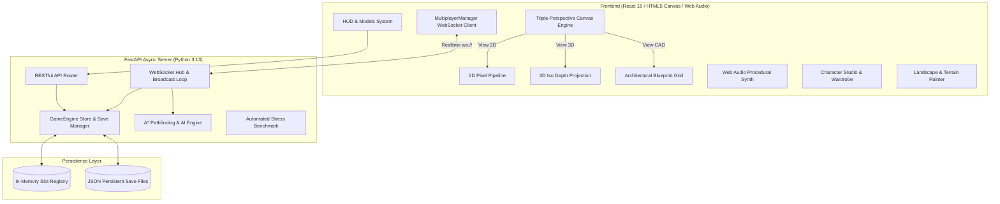

# EVERGREEN CHRONICLES — TECHNICAL ARCHITECTURE
**Date**: November 9, 2026  
**Document**: Technical System Architecture & Data Specifications  

---

## 1. High-Level System Architecture



---

## 2. Personalization Subsystem Data Models (P1)

### 2.1 Character Profile Schema (`CharacterProfile`)
```python
class CharacterAppearance(BaseModel):
    skin_tone: str = "tone_warm_fair"        # tone_pale, tone_warm_fair, tone_olive, tone_deep_amber, tone_obsidian, tone_celestial_blue, tone_draconic_crimson
    face_shape: str = "shape_oval"           # shape_oval, shape_angular, shape_round, shape_chiseled
    hair_style: str = "style_adventurer"     # style_adventurer, style_braided_long, style_spiky, style_wavy_bob, style_elven_twin, style_dwarven_bun
    hair_color: str = "#b45309"              # Hex color code
    hair_highlight: Optional[str] = "#fde047"
    eye_color: str = "#2563eb"               # Hex color code
    facial_marking: Optional[str] = None     # None, freckles, scar_cheek, mystic_rune, battle_paint
    body_build: str = "balanced"             # slender, balanced, muscular, petite
    horns: Optional[str] = None              # None, horns_draconic, horns_curled, horns_crystal
    ears: str = "ears_human_round"           # ears_human_round, ears_elven_long, ears_beast_fluffy, ears_fin_aquatic
    tail: Optional[str] = None               # None, tail_beast_fluffy, tail_dragon_scaled, tail_sylph_wisp
    wings: Optional[str] = None              # None, wings_fairy_glimmer, wings_dragon_leather

class CharacterWardrobe(BaseModel):
    headwear: Optional[str] = "hat_straw"
    top: str = "tunic_red_classic"
    bottom: str = "pants_blue_overalls"
    footwear: str = "boots_leather_work"
    accessory: Optional[str] = None
    back_item: Optional[str] = "backpack_leather"
    outfit_presets: Dict[str, Dict[str, Optional[str]]] = {
        "work": {"top": "tunic_red_classic", "bottom": "pants_blue_overalls", "headwear": "hat_straw"},
        "adventure": {"top": "armor_iron_mail", "bottom": "pants_hardy_leather", "headwear": "helm_iron"},
        "formal": {"top": "robe_velvet_royal", "bottom": "trousers_silk_gold", "headwear": "crown_laurel"}
    }
```

### 2.2 Race Registry (`RACES_DATABASE`)
10 fully defined playable races with passive perks and background lore:
1. **`race_human`**: *Versatile Pioneers* — +10% Experience gain in all professions, standard stamina recovery.
2. **`race_high_elf`**: *Children of the First Canopy* — +25% Crop growth speed on natural plants, innate botanical intuition.
3. **`race_dwarf`**: *Deep Forge Smiths* — +35% Mining yield, high durability on pickaxes and heavy metal tools.
4. **`race_beastfolk`**: *Wildkin Empaths* — Animals produce +50% happiness gold, 15% bonus movement speed on grass.
5. **`race_dragonkin`**: *Ignis Sovereign* — Immunity to volcanic heat, stamina consumption reduced by 20% during heavy labor.
6. **`race_sylph`**: *Breeze Dancers* — 25% Base movement speed boost, sprint stamina cost reduced to zero.
7. **`race_fairykin`**: *Flora Sylvans* — Shimmer aura illuminates surroundings at night, rare flower harvest rates doubled.
8. **`race_tideborn`**: *Azure Mariners* — Fishing mini-game sweet spot widened by 40%, special sea creature attraction.
9. **`race_golemkin`**: *Aetherforged* — Immune to physical exhaustion, crafting material costs reduced by 15%.
10. **`race_shadowborn`**: *Nocturnal Stalkers* — Move +30% faster at night, high-tier loot bonus in nighttime dungeons.

### 2.3 Personality & Background Profiles
- **12 Personality Types**: Kind, Brave, Curious, Ambitious, Creative, Introverted, Outgoing, Calm, Adventurous, Practical, Scholarly, Mischievous.
- **8 Background Origins**: Former Merchant, Village Heir, Wandering Adventurer, Apprentice Engineer, Royal Refugee, Traveling Scholar, Forest Guardian, Unknown Wanderer.

---

## 3. Creative Freedom Subsystem (P2)

### 3.1 Landscape & Terrain Brush Engine
- **Tiles Data Structure**: Extended from 16x16 to dynamic chunk matrix `Dict[str, List[List[FarmTile]]]`.
- **Supported Terrain Brushes**:
  - `brush_grass_meadow` (Green meadow)
  - `brush_sand_dune` (Desert oasis sand)
  - `brush_snow_tundra` (Frosty snowlands)
  - `brush_marsh_swamp` (Wetland peat)
  - `brush_stone_cobble` (Paved town roadway)
  - `brush_volcanic_ash` (Lava rock)
  - `brush_water_shallow` (Fishable water canal)
  - `brush_water_deep` (Deep navigable lake)
- **Editor Operations**: Single-tile brush, 3x3 stamp, line path drawer, area fill, undo/redo stack (`max_history = 30`).

### 3.2 Sky & Parallax Atmosphere Engine
- 5 Visual Depth Layers rendered in sequence:
  - **Layer 1 (Horizon Sky)**: Procedural linear gradient modulated by calendar season and hour of day.
  - **Layer 2 (Distant Peaks)**: Mountain silhouettes moving at 0.1x parallax speed.
  - **Layer 3 (Drifting Clouds)**: Procedural cloud masses drifting at variable wind velocity.
  - **Layer 4 (Forest Fringe)**: Tree line silhouettes moving at 0.4x parallax speed.
  - **Layer 5 (Main World Canvas)**: Active interactive tile grid, entities, player, tractor.
  - **Layer 6 (Atmospheric Overlay)**: Directional rain streaks, night fireflies, ambient fog.

---

## 4. State Persistence & Migration Strategy

To guarantee **zero regression** and preserve existing player save data:
1. **Backward-Compatible Default Factories**:
   When loading an existing save file lacking new schema keys (`character_profile`, `wardrobe`, `landscape_customizations`):
   The backend auto-migrates missing keys using typed defaults.
2. **Atomic Disk Commits**:
   Game saves write first to a temporary atomic file (`save_slot_1.tmp.json`) before renaming to prevent corruptions during unexpected power cuts.
3. **Data Verification Suite**:
   Pytest suite tests save/load roundtrips ensuring every customized hair color, race trait, and placed blueprint tile persists flawlessly.
